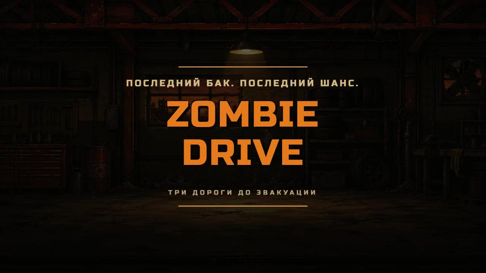
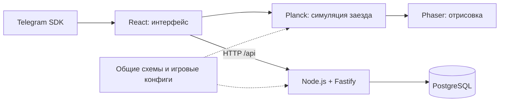

# Zombie Drive

## Описание проекта

Автомобильная игра для Telegram Mini App в духе Earn to Die. Нужно пробиться через зомби и завалы, заработать на улучшения и добраться до эвакуационного пункта.

В игре три маршрута: заброшенные холмы на внедорожнике, промзона на КамАЗе и горный перевал на Audi R8. Следующая машина открывается после прохождения предыдущего этапа. Награда зависит от расстояния и убитых зомби; повторное прохождение завершённого этапа денег не приносит.

Физика работает на устройстве игрока. Прогресс, покупки и результаты хранятся на сервере. В Telegram профиль привязан к Telegram ID, для локальной разработки доступен гостевой вход.

Проект полностью OpenSource и создан исключительно для некоммерческого использования с образовательной целью.

[](media/zombie-drive-trailer.mp4)

[Смотреть трейлер · 46 секунд](media/zombie-drive-trailer.mp4)

## Стек

| Часть | Технологии |
| --- | --- |
| Язык | TypeScript |
| Интерфейс | React |
| Отрисовка | Phaser |
| Физика | Planck / Box2D |
| Сервер | Node.js, Fastify |
| Хранение данных | PostgreSQL, чистый SQL без ORM |
| Проверка данных | Zod |
| Сборка и проверки | Vite, ESLint, Vitest |
| Развёртывание | Docker Compose, Caddy, Yandex Cloud |

## Архитектура



- `apps/web` — интерфейс, графика, физика, звук и интеграция с Telegram.
- `apps/api` — авторизация, прогресс, покупки и расчёт результатов.
- `packages/shared` — схемы запросов, настройки машин, маршрутов и экономики.
- `apps/web/src/configs` — графика, звук, управление и сценарии роликов.

API проверяет подпись Telegram, доступность покупок и правдоподобие отчётов. Повторные запросы старта, покупки и сохранения результата не дублируют операции. 

В проде Caddy принимает HTTPS-запросы, Fastify отдаёт клиент и API с одного адреса, PostgreSQL хранит данные в постоянном Docker-томе.

## Команды

Нужен Node.js 22.12 или новее. Для разработки:

```sh
npm install
npm run dev
```

Игра откроется на http://localhost:5173. Команда запускает клиент, API и локальный PostgreSQL на `127.0.0.1:55432`. Данные сохраняются в `.local/postgres`. При заданном `DATABASE_URL` используется указанная база.

| Команда | Назначение |
| --- | --- |
| `npm run dev` | Запустить клиент, API и локальную БД |
| `npm run dev:web` | Запустить только Vite |
| `npm run dev:api` | Запустить API с перезапуском при изменениях; нужна доступная БД |
| `npm run typecheck` | Проверить типы TypeScript |
| `npm run lint` | Проверить стиль и правила качества |
| `npm run lint:fix` | Исправить оформление автоматически |
| `npm test` | Запустить тесты с отдельной временной БД |
| `npm run build` | Собрать клиент в `dist/web` |
| `npm run check` | Проверить типы, стиль, тесты и сборку |
| `npm start` | Запустить API и собранный клиент |
| `npm run deploy` | Собрать, проверить и выложить приложение на настроенную ВМ |

Тесты не используют `.local/postgres`. Переменные окружения перечислены в `.env.example` и `.env.production.example`.

[Настройка Telegram](docs/telegram.md) · [Развёртывание в Yandex Cloud](docs/deployment-yc.md) · [Правила игры](docs/game-concept.md) · [Графика и звук](docs/art-direction.md).
